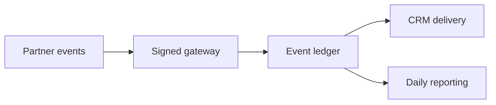

# Engineering portfolio

**Andrey Pokotilo** · Backend engineering, integrations, data pipelines, and cloud operations.

This portfolio includes [selected project source](source/README.md) from a team product and runnable examples based on the same engineering problems. The examples use fictional records and local test doubles.

## Explore the work

| Area | Engineering problem | Example |
| --- | --- | --- |
| Partner attribution | Track registration events, preserve unlinked events, and reconcile totals by date | [CSV and attribution pipeline](portfolio/pipelines.py) |
| Webhooks and conversion delivery | Persist an event before downstream actions, handle retries, and keep uncertain deliveries visible | [SQLite event ledger and outbox](portfolio/events.py) |
| CRM automation | Match records by verified identities, protect regional routing, and reject ambiguous updates | [Identity reconciliation](portfolio/pipelines.py) |
| User and chat exports | Detect incomplete pages, reject mismatched counts, and keep conversation identities separate | [Export validation](portfolio/history.py) |
| Scheduling and attendance | Normalize regional slots to UTC, handle DST and count overlapping joins once | [Calendar and attendance](portfolio/workflows.py) |
| Analytics operations | Distinguish missing data from zero activity and isolate upstream vs. downstream lag | [Freshness checks](portfolio/pipelines.py) · [PostgreSQL query](examples/analytics.sql) |
| AI-assisted review | Separate inactivity detection from causal claims and verify evidence IDs in model output | [Inactivity](portfolio/workflows.py) · [Evidence validation](portfolio/history.py) |
| Cloudflare and release safety | Verify signed ingress, route through a service binding, and gate an isolated preview | [Worker](edge/worker.mjs) · [Preview checks](edge/release.mjs) |

[Engineering case notes](docs/case-studies.md) describe the original contribution areas and what each example demonstrates.

## Run locally

With Python 3.11+ and Node.js 22+:

```bash
python -m portfolio.demo
python -m unittest discover -s tests -v
node --test edge/worker.test.mjs
```

The Python demo prints attribution totals, a duplicate webhook result, a delayed mart, a UTC booking window, and a churn review candidate. The tests exercise edge request signing and routing with an in-memory backend binding.

## Replay the data workflow

Run the [offline replay](portfolio/replay.py) with an unused output path.

```bash
python -m portfolio.replay --csv /tmp/portfolio-registrations.csv
```

The replay writes one row per referral code and registration date, reports daily attribution totals, verifies signed registration events, and proposes click ID updates for uniquely matched contacts. It uses a local event ledger and a deterministic stand-in for the AI analysis. The [review code](portfolio/review.py) only requests an analysis once the inactivity window is complete and validates evidence references before marking the report for human review.

The [PostgreSQL migration](examples/postgres/001_daily_registration.sql) models a daily reporting mart in a dedicated demo schema. The [smoke test](examples/postgres/smoke.sql) checks a repeated import, a missing day, and a completed day with zero registrations. Run both in an empty local PostgreSQL database.

```bash
psql -X -v ON_ERROR_STOP=1 -d portfolio_demo \
  -f examples/postgres/001_daily_registration.sql \
  -f examples/postgres/smoke.sql
```

The replay and SQL fixtures are independent examples. All event, contact, and report data in them are fictional.

## How the examples fit together



CSV input and the local SQLite database are intentionally small so each failure mode is easy to reproduce. SQL, cloud routing and review workflows are independent examples.
